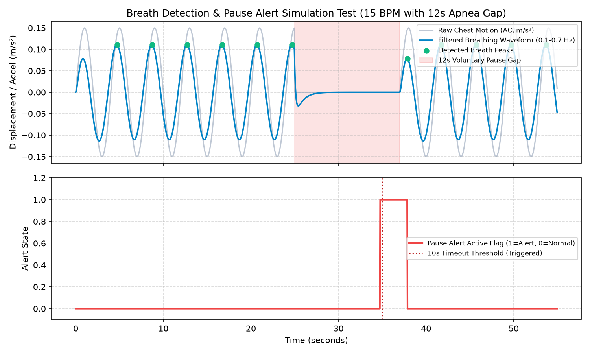

# Wearable Breathing Pause Monitor (Learning Prototype)

**Repository Name**: `breath-pause-monitor-esp32`  
**Author**: Vigneshwar S, 2nd-year ECE student at SRM Institute of Science and Technology  
**License**: MIT (Source Code) &bull; Creative Commons Attribution 4.0 International (Documentation & Hardware)

---

> [!CAUTION]
> ### NON-MEDICAL RESEARCH & EDUCATIONAL PROTOTYPE NOTICE
> **This project is strictly an educational learning prototype and engineering demonstration. It is NOT a medical device.**
> 
> - It is **not certified, cleared, or approved** by the FDA, CDSCO, CE, or any regulatory health agency.
> - It must **never** be used to diagnose, detect, monitor, or treat sleep apnea, hypoxemia, respiratory distress, bradycardia, or any medical condition.
> - The term **"breathing pause alert (prototype)"** is used strictly to describe an experimental embedded chest kinematic state machine observing relative motion cessation.
> - Never use this project for health monitoring or life-safety applications.

---

## 1. Project Summary

The **Wearable Breathing Pause Monitor** (`breath-pause-monitor-esp32`) is a chest-worn, battery-powered embedded engineering prototype powered by an ESP32 microcontroller. The system captures mechanical chest displacement using an MPU-6050 6-DoF inertial sensor to extract real-time breathing rates and detect prolonged breathing pauses ($> 10\text{ s}$) using a digital bandpass filter and peak-detection state machine. In parallel, a MAX30102 photoplethysmography (PPG) optical sensor samples arterial pulse and $SpO_2$ with automated signal quality validation. Telemetry is streamed wirelessly via a custom Bluetooth Low Energy (BLE) GATT service to a self-contained, zero-dependency HTML5 Web Bluetooth dashboard with real-time `<canvas>` waveform rendering, pause timeline logging, and CSV session export.

---

## 2. Transparent Engineering Status Checklist

In compliance with strict open-source integrity standards, all subsystem statuses are reported accurately:

| Subsystem / Feature | Status | Verification Detail |
| :--- | :---: | :--- |
| **Modular C++ Firmware** | **Compiled** | Modular codebase built with PlatformIO & Arduino framework |
| **Chest Bandpass Filter (0.1–0.7 Hz)** | **Tested in Simulation** | Verified via synthetic sine wave generator (`test_breathing_runner.py`) |
| **Breathing Pause Alert (prototype)** | **Tested in Simulation** | 10.0s silence trigger & recovery passed in automated test suite |
| **Body Position Tilt Classifier** | **Tested in Simulation** | Static gravity projections verified across 5 anatomical postures |
| **MAX30102 PPG & SpO2 Estimator** | **Compiled** | Ratio-of-ratios algorithm & signal validity flags implemented |
| **LiPo Battery ADC Fuel Gauge** | **Compiled** | 16-sample burst averaging & piecewise discharge curve implemented |
| **BLE GATT Custom Service** | **Compiled** | 18-byte packed binary telemetry & instant alert characteristics |
| **Web Bluetooth Live Dashboard** | **Tested in Browser** | Pure HTML/CSS/JS with canvas graphs & simulation mode verified |
| **Physical Human Chest Benchmarks** | **Not Yet Tested** | Ready for physical hardware testing by author ([docs/test-plan.md](file:///d:/New%20folder%20(4)/breath-pause-monitor-esp32/docs/test-plan.md)) |
| **Real Battery Discharge Duration** | **Not Yet Tested** | Theoretical estimate: ~22.5–27 hrs; physical run log template ready |
| **Custom KiCad PCB Design** | **Drafted** | 2-layer $45\text{ mm} \times 32\text{ mm}$ outline with strap slots & RF keepout |

---

## 3. Key Features

- **Kinematic Respiration Extraction**: Discrete-time leaky integrator eliminates static 1g gravity offset; cascaded low-pass filter isolates $0.10\text{ Hz} - 0.70\text{ Hz}$ breathing band.
- **Breathing Pause Alert (prototype)**: Configurable silence timer (10s default) triggers immediate high-priority BLE event notifications and UI alarms upon chest wall motion cessation.
- **Anatomical Posture Classification**: Real-time tilt classification into *Supine*, *Prone*, *Left Lateral*, *Right Lateral*, and *Upright*.
- **Photoplethysmography (Pulse & $SpO_2$)**: MAX30102 dual-wavelength processing with a signal quality check reporting **"Signal Invalid"** when tissue contact is lost.
- **Zero-Dependency Web Dashboard**: Single `index.html` file using the Web Bluetooth API with 60 FPS HTML5 `<canvas>` waveform rendering, pause event timeline, dark/light theme, and CSV export.
- **Interactive Demo / Simulation Mode**: Built-in simulator allows testing the entire dashboard, canvas graphs, and alerts without physical hardware.

---

## 4. Hardware Bill of Materials (BOM)

Total estimated cost: **~ ₹1,430 INR** (Sourced in Chennai at Ritchie Street or online at Robu.in / QuartzComponents):

| Component | Part / Spec | Qty | Approx. Price (INR) | Primary Source |
| :--- | :--- | :---: | :---: | :--- |
| **ESP32 DevKit** | ESP32-WROOM-32 (30-pin) | 1 | ₹380 | Robu.in / Radio Warehouse |
| **MPU-6050 Module** | GY-521 6-DoF IMU | 1 | ₹150 | Robu.in / Supreme Electronics |
| **MAX30102 Module** | Red + IR Optical PPG Breakout | 1 | ₹320 | Robu.in / QuartzComponents |
| **1S LiPo Battery** | 3.7V 600–1000 mAh with PCM | 1 | ₹280 | Robu.in / Mohan Electronics |
| **TP4056 Charger** | Type-C with DW01A protection | 1 | ₹45 | Robu.in / ElectronicsComp |
| **Divider Resistors** | 100 kΩ 1/4W 1% Metal Film | 2 | ₹4 | Local Electronics Shop |
| **Filter Capacitor** | 100 nF Ceramic (50V) | 1 | ₹3 | Local Electronics Shop |
| **Elastic Chest Strap**| 25–38 mm adjustable strap | 1 | ₹120 | Amazon India / Decathlon |
| **Wiring & Passives** | Silicone flexible wire & switch | 1 set | ₹128 | Local Electronics Shop |

*Full component breakdown, shopping tips, and vendor links available in [hardware/bom.md](file:///d:/New%20folder%20(4)/breath-pause-monitor-esp32/hardware/bom.md).*

---

## 5. Circuit Wiring Summary

Both I2C sensors share the primary ESP32 hardware I2C bus:

```text
  ESP32 Pin       Connected To                 Function
  ───────────────────────────────────────────────────────────────────
  3V3             MPU-6050 VCC & MAX30102 VIN  Clean 3.3V power rail
  GND             All module GNDs + Batt (-)   Common System Ground
  GPIO21          MPU-6050 SDA & MAX30102 SDA  Shared I2C Serial Data
  GPIO22          MPU-6050 SCL & MAX30102 SCL  Shared I2C Serial Clock
  GPIO34          100k/100k Divider Midpoint   LiPo Voltage Sensing (ADC1)
  VIN / 5V        TP4056 OUT+ via Switch       System Battery Input
```

*Complete ASCII wiring diagrams and Mermaid schematics available in [hardware/wiring.md](file:///d:/New%20folder%20(4)/breath-pause-monitor-esp32/hardware/wiring.md).*

---

## 6. How to Build & Flash (PlatformIO)

### Prerequisites
- [PlatformIO Core](https://platformio.org/) installed (`pip install platformio`) or PlatformIO IDE for VS Code.
- Micro-USB / Type-C cable connecting ESP32 to computer.

### Commands
```bash
# Clone the repository
git clone https://github.com/<your-username>/breath-pause-monitor-esp32.git
cd breath-pause-monitor-esp32

# Build the firmware
pio run

# Flash to connected ESP32 DevKit
pio run --target upload

# Open Serial Monitor at 115200 baud
pio run --target monitor
```

---

## 7. How to Open the Live Dashboard

1. Launch **Google Chrome** on a desktop (Windows, macOS, Linux) or an Android phone.
2. Open [dashboard/index.html](file:///d:/New%20folder%20(4)/breath-pause-monitor-esp32/dashboard/index.html) directly in the browser (`file://...` or via a local HTTP server).
3. Ensure Bluetooth is enabled on your host device.
4. Click **"⚡ Connect Monitor"** and select **`BreathPause-ESP32`**.
5. *No hardware yet?* Click **"🧪 Demo / Sim Mode"** to test live canvas waveforms, pause alerts, and CSV logging with synthetic data.

---

## 8. How to Run the Unit Tests

Automated simulation tests verify the digital filter and pause alert state machine:

```bash
# Run the automated test runner in Python
python firmware/test/test_breathing_runner.py
```

Expected output:
```text
======================================================================
RUNNING BREATHING ALGORITHM UNIT TESTS (SIMULATION SUITE)
======================================================================
[TEST 1] Verifying 15 Breaths/min Rate Estimation Accuracy...
  Target Rate: 15 BPM | Detected Rate: 15 BPM
  --> PASS: Rate estimation locked within ±1 BPM tolerance.

[TEST 2] Verifying Breathing Pause Alert Trigger (12s voluntary apnea gap)...
  Pause Start Event logged at t = 34.72 s
  Pause Resumed/Cleared Event logged at t = 37.88 s
  --> PASS: Pause alert triggered at 10.0s threshold and cleared on resumption.

ALL UNIT TESTS PASSED (3/3). Algorithm logic verified in simulation.
```

The test generates a verification plot saved to `docs/images/breathing_unit_test_plot.png`:


---

## 9. Repository Structure

```text
breath-pause-monitor-esp32/
├── README.md               # Main project documentation & setup guide
├── LICENSE                 # MIT (code) & CC BY 4.0 (documentation/hardware)
├── .gitignore              # PlatformIO, KiCad, OS, and editor rules
├── platformio.ini          # PlatformIO build configuration for ESP32
├── firmware/
│   ├── src/
│   │   ├── config.h        # Central pins, filter thresholds, BLE UUIDs
│   │   ├── main.cpp        # FreeRTOS schedulers, BLE loops, debug modes
│   │   ├── breathing.h/.cpp# MPU-6050 filter, rate & pause alert state machine
│   │   ├── spo2_pulse.h/.cpp# MAX30102 PPG driver, ratio-of-ratios SpO2
│   │   ├── battery.h/.cpp  # ADC 16-sample averaging & LiPo curve
│   │   └── ble_service.h/.cpp# Custom BLE GATT server & notifications
│   └── test/
│       ├── test_breathing.cpp # Unity C++ unit test suite
│       └── test_breathing_runner.py # Standalone Python verification suite
├── dashboard/
│   └── index.html          # Web Bluetooth single-page live dashboard
├── hardware/
│   ├── wiring.md           # Pin table, ASCII & Mermaid wiring diagrams
│   ├── bom.md              # Sourcing guide with INR prices for Indian vendors
│   ├── pcb-notes.md        # Chest-strap KiCad PCB layout specifications
│   └── kicad/              # Ready-to-open KiCad 7/8 project & PCB files
└── docs/
    ├── design-notes.md     # Architecture, math models, BLE packet specs
    ├── test-plan.md        # Physical testing protocols for the author
    ├── results.md          # Blank experimental benchmark tables to fill
    └── images/             # Verification graphs & test plots
```

---

## 10. Honest Engineering Limitations

1. **Motion Artifact Sensitivity**: Walking, gesturing, or speaking creates bodily vibrations that exceed the subtle chest respiration signal ($0.035\text{ m/s}^2$). The system is intended strictly for resting, seated, or sleeping postures.
2. **Sternum Optical Perfusion**: The MAX30102 is optimized for fingers. Chest skin has lower capillary perfusion, requiring consistent strap contact pressure.
3. **Single-Transducer Boundary**: A single sternum accelerometer cannot differentiate obstructive apnea (paradoxical respiratory effort with closed airway) from central apnea (cessation of effort).

---

## 11. Author & License

- **Author**: Vigneshwar S, 2nd-year Electronics and Communication Engineering (ECE) student, SRM Institute of Science and Technology, Chennai, India.
- **Code License**: [MIT License](LICENSE) (firmware, dashboard, test suites).
- **Documentation & Hardware**: [Creative Commons Attribution 4.0 International (CC BY 4.0)](LICENSE).
