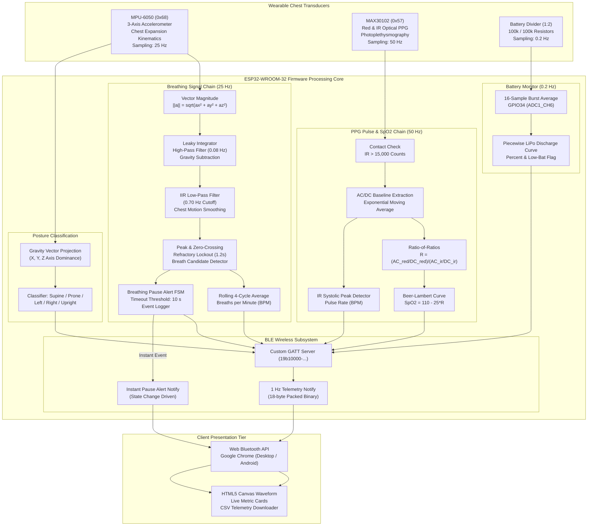
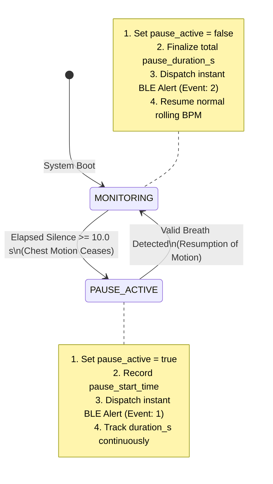

# System Design Notes & Technical Architecture

Project: Wearable Breathing Pause Monitor (learning prototype)  
Author: Vigneshwar S, 2nd-year ECE student at SRM Institute of Science and Technology

> [!CAUTION]
> Non-Medical Educational Device. This document provides engineering analysis, mathematical models, and firmware architecture for academic study and prototype construction.

---

## 1. System Block Diagram & Data Flow

---

## 2. Mathematical Signal Processing Models

### A. Chest Motion Filtering (Breathing Extraction)
During eupneic (normal resting) breathing, the human chest wall expands and contracts at approximately 10 to 24 breaths per minute ($0.16\text{ Hz}$ to $0.40\text{ Hz}$). The total acceleration magnitude $a_{mag}(t)$ includes an unavoidable static $1\text{g}$ ($9.81\text{ m/s}^2$) gravitational component:

$$a_{mag}[n] = \sqrt{a_x[n]^2 + a_y[n]^2 + a_z[n]^2}$$

1. **Leaky Integrator for DC Gravity Removal**:
   To eliminate the gravitational baseline without an expensive high-order Butterworth high-pass filter, a leaky integrator baseline tracker is implemented:
   $$y_{dc}[n] = \alpha_{dc} \cdot y_{dc}[n-1] + (1 - \alpha_{dc}) \cdot a_{mag}[n]$$
   $$x_{ac}[n] = a_{mag}[n] - y_{dc}[n]$$
   With $\alpha_{dc} = 0.95$ at sampling frequency $f_s = 25\text{ Hz}$, the high-pass cutoff is approximately $0.08\text{ Hz}$.

2. **Low-Pass Smoothing Filter**:
   To reject high-frequency muscular tremor and cardiac vibrations, an exponential low-pass filter is cascaded:
   $$y_{filt}[n] = \alpha_{lp} \cdot x_{ac}[n] + (1 - \alpha_{lp}) \cdot y_{filt}[n-1]$$
   With $\alpha_{lp} = 0.25$, this provides effective noise rejection above $0.70\text{ Hz}$.

3. **Breath Cycle Peak Detection & Lockout**:
   - A candidate peak is confirmed when $y_{filt}[n]$ reverses direction from rising to falling and exceeds the threshold:
     $$y_{peak} \ge 0.035\text{ m/s}^2$$
   - To prevent false double-counting caused by dicrotic respiratory notches, a refractory lockout period is enforced:
     $$T_{refractory} = 1.20\text{ seconds} \quad (\text{Limits peak rate to } \le 50\text{ BPM}).$$

4. **Rolling Average Respiration Rate**:
   For the last $K = 4$ valid inter-breath intervals $\Delta t_i$:
   $$\text{BPM} = \frac{60}{\frac{1}{K} \sum_{i=1}^K \Delta t_i}$$

---

### B. Breathing Pause Alert (prototype) Finite State Machine

---

### C. Photoplethysmography (SpO2 & Heart Rate)
The MAX30102 shines two wavelengths into vascular bed tissue:
- **Red LED** ($\lambda = 660\text{ nm}$): Highly absorbed by deoxygenated hemoglobin ($Hb$).
- **Infrared LED** ($\lambda = 880\text{ nm}$): Highly absorbed by oxygenated hemoglobin ($HbO_2$).

1. **Optical Signal Decomposition**:
   Each photodiode channel yields a total signal containing a non-pulsatile DC level (bone, venous blood, tissue) and a pulsatile AC level (arterial blood volume pulse):
   $$\text{Raw}(t) = \text{DC} + \text{AC}(t)$$

2. **Ratio-of-Ratios ($R$)**:
   Applying the modified Beer-Lambert law:
   $$R = \frac{\left( \frac{\text{AC}_{red}}{\text{DC}_{red}} \right)}{\left( \frac{\text{AC}_{ir}}{\text{DC}_{ir}} \right)}$$

3. **SpO2 Empirical Polynomial Calibration**:
   $$SpO_2 (\%) = 110 - 25 \times R$$

4. **Signal Quality & Motion Guard**:
   If raw infrared counts fall below $15,000$ (indicating no tissue contact) or if the computed ratio produces $SpO_2 < 70\%$, the firmware marks the reading as `SIGNAL_INVALID` and outputs `0` rather than generating misleading synthetic values.

---

## 3. Bluetooth Low Energy (BLE) Protocol Specification

### Service & Characteristic Architecture
- **Primary Service UUID**: `19b10000-e8f2-537e-4f6c-d104768a1214`

| Characteristic | UUID | Properties | Frequency | Purpose |
| :--- | :--- | :---: | :---: | :--- |
| **Telemetry** | `...-0001` | Read, Notify | 1 Hz | Streaming live vital signs and waveform |
| **Pause Alert** | `...-0002` | Read, Notify | On Event | High-priority instant pause notifications |
| **Config / Control** | `...-0003` | Read, Write | On Demand | Remote tuning of pause timeout threshold |

### Telemetry Characteristic Binary Structure (18 Bytes Total)

| Byte Offset | Field Name | Data Type | Units / Scale | Valid Range | Description |
| :---: | :--- | :---: | :---: | :---: | :--- |
| `0..3` | `timestamp_ms` | `uint32_t` | Milliseconds | $0 - 2^{32}-1$ | ESP32 uptime timer (`millis()`) |
| `4..7` | `breath_wave` | `float` (IEEE 754) | $\text{m/s}^2$ | $\pm 5.0$ | Filtered chest displacement signal |
| `8` | `breathing_rate_bpm` | `uint8_t` | BPM | $0 - 60$ | Rolling average respiration rate |
| `9` | `pause_active` | `uint8_t` | Boolean | $0 \text{ or } 1$ | $1 = \text{Breathing pause active}$ |
| `10..11` | `pause_duration_s` | `uint16_t` | Seconds | $0 - 65535$ | Current or last pause duration |
| `12` | `heart_rate_bpm` | `uint8_t` | BPM | $0, 40 - 210$ | Pulse rate ($0 = \text{Invalid}$) |
| `13` | `spo2_percent` | `uint8_t` | % | $0, 70 - 100$ | Blood oxygen saturation ($0 = \text{Invalid}$) |
| `14` | `signal_quality` | `uint8_t` | Enum | $0, 1, 2$ | $0=\text{Invalid}, 1=\text{Degraded}, 2=\text{Optimal}$ |
| `15` | `body_position` | `uint8_t` | Enum | $0 - 5$ | $1=\text{Supine}, 2=\text{Prone}, 3=\text{L}, 4=\text{R}, 5=\text{Up}$ |
| `16` | `battery_percent` | `uint8_t` | % | $0 - 100$ | LiPo State of Charge |
| `17` | `is_simulated` | `uint8_t` | Boolean | $0 \text{ or } 1$ | $1 = \text{Synthetic Demo Mode}$ |

---

## 4. Power Consumption Model & Battery Optimization

### Current Consumption Breakdown

| Subsystem Mode | Typical Current ($I_{typ}$) | Active Duty Cycle | Weighted Current Contribution |
| :--- | :---: | :---: | :---: |
| **ESP32 Active BLE Transmission** | $130\text{ mA}$ | $1.5\%$ | $\sim 1.95\text{ mA}$ |
| **ESP32 Dual-Core Modem-Sleep** | $20\text{ mA}$ | $98.5\%$ | $\sim 19.70\text{ mA}$ |
| **MPU-6050 Accelerometer** | $3.8\text{ mA}$ | $100\%$ | $3.80\text{ mA}$ |
| **MAX30102 PPG Optical LEDs** | $1.2\text{ mA}$ | $100\%$ | $1.20\text{ mA}$ |
| **100k/100k Voltage Divider** | $0.019\text{ mA}$ | $100\%$ | $0.02\text{ mA}$ |
| **Estimated Average Total** | | | **$\sim 26.67\text{ mA}$** |

### Theoretical Battery Life Estimate
For a standard single-cell $600\text{ mAh}$ LiPo battery:
$$T_{battery} = \frac{\text{Capacity}}{\bar{I}_{total}} = \frac{600\text{ mAh}}{26.67\text{ mA}} \approx 22.5\text{ Hours}.$$

*Note: In future PCB revisions, switching to ESP32 Light-Sleep between 40 ms sampling ticks can reduce idle controller current down to $< 1.5\text{ mA}$, extending theoretical battery runtime to $> 60\text{ hours}$.*

---

## 5. Known Limitations & Technical Constraints

1. **Motion Artifacts on Accelerometer**:
   Walking, limb movement, coughing, or talking generates bodily accelerations exceeding $0.5\text{g} - 2.0\text{g}$, completely overwhelming the subtle chest wall respiration signal ($0.05\text{g}$). The monitor is designed and tested for resting, seated, or sleeping states.
2. **Optical Sternum Coupling**:
   The MAX30102 was originally engineered for fingertips, where capillary density is extremely high. On the human sternum, microvascular perfusion is considerably lower, leading to reduced signal-to-noise ratio (SNR). Proper strap tension is critical: too loose introduces ambient optical noise; too tight blanches local capillaries.
3. **Single-IMU Apnea Limitation**:
   A single sternum accelerometer cannot differentiate between obstructive apnea (where the chest wall continues paradoxical respiratory efforts against a closed airway) and central apnea (where respiratory effort ceases entirely).

---

## 6. Next Steps & Development Roadmap

1. **Custom KiCad 2-Layer PCB**: Transition from DevKit wires to the $45\text{ mm} \times 32\text{ mm}$ integrated board specified in [hardware/pcb-notes.md](file:///d:/New%20folder%20(4)/breath-pause-monitor-esp32/hardware/pcb-notes.md).
2. **3D Printed TPU Flexible Casing**: Enclosure with curved backing and skin-friendly silicone gasket around the MAX30102 optical aperture.
3. **Dual-Sensor Fusion**: Adding a secondary IMU or thoracic bio-impedance measurement to distinguish central from obstructive breathing pauses.
