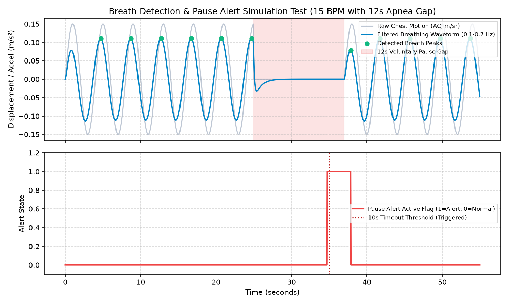

# Experimental Results & Hardware Benchmarks

Project: Wearable Breathing Pause Monitor (learning prototype)  
Author: Vigneshwar S, 2nd-year ECE student at SRM Institute of Science and Technology

> [!IMPORTANT]
> ### HONEST BENCHMARKING POLICY
> In accordance with strict open-source academic integrity guidelines:
> - **No test results, battery life figures, or accuracy percentages are invented.**
> - All tables below are formatted templates ready for the author (Vigneshwar S) to fill in after performing physical hardware experiments following [docs/test-plan.md](file:///d:/New%20folder%20(4)/breath-pause-monitor-esp32/docs/test-plan.md).
> - Algorithms verified via automated software simulation are reported in Section 7.

---

## Table 1: Breathing Rate Validation (TP-01 & TP-02)

| Trial ID | Test Condition | Manual Count (1 min) [BPM] | Prototype Reported [BPM] | Absolute Error [BPM] | Error (%) | Notes & Observations |
| :---: | :--- | :---: | :---: | :---: | :---: | :--- |
| **BR-01** | Resting (Supine) | | | | | |
| **BR-02** | Resting (Supine) | | | | | |
| **BR-03** | Resting (Seated Upright) | | | | | |
| **BR-04** | Resting (Seated Upright) | | | | | |
| **BR-05** | Post-Light Movement (Walking) | | | | | |
| **BR-06** | Post-Light Movement (Walking) | | | | | |
| **BR-07** | Shallow Breathing | | | | | |
| **BR-08** | Deep Breathing | | | | | |
| **AVG**   | *Overall Mean* | | | | | |

---

## Table 2: Breathing Pause Alert Response Times (TP-03)

Configured Firmware Timeout: **10.0 seconds** (`PAUSE_ALERT_TIMEOUT_MS = 10000U`).

| Trial ID | Intended Breath-Hold [s] | Stopwatch Measured Time to Alert [s] | Prototype Logged Duration [s] | Delay from 10s Target [s] | Clearance Latency on Resumption [s] | Notes |
| :---: | :---: | :---: | :---: | :---: | :---: | :--- |
| **PA-01** | 12 s | | | | | Safe voluntary hold (seated) |
| **PA-02** | 12 s | | | | | Safe voluntary hold (seated) |
| **PA-03** | 15 s | | | | | Safe voluntary hold (seated) |
| **PA-04** | 15 s | | | | | Safe voluntary hold (seated) |
| **PA-05** | 8 s (Sub-threshold) | *(Should not trigger)* | *(Should be 0)* | N/A | N/A | Sub-threshold sanity check |
| **AVG**   | | | | | | |

---

## Table 3: Pulse & SpO2 Optical Agreement (TP-04)

Comparison against commercial fingertip pulse oximeter reference.

| Reading ID | Reference HR [BPM] | Prototype HR [BPM] | HR Error [BPM] | Reference SpO2 [%] | Prototype SpO2 [%] | SpO2 Error [%] | Signal Quality Flag | Skin Contact Status |
| :---: | :---: | :---: | :---: | :---: | :---: | :---: | :---: | :--- |
| **OX-01** | | | | | | | | Normal seated contact |
| **OX-02** | | | | | | | | Normal seated contact |
| **OX-03** | | | | | | | | Normal seated contact |
| **OX-04** | | | | | | | | Normal seated contact |
| **OX-05** | | | | | | | | Loose chest strap |
| **OX-06** | N/A (Lifted) | | | N/A (Lifted) | | | | Sensor detached from skin |

---

## Table 4: Body Position Classification Accuracy (TP-05)

| Posture Tested | Physical Target Angle | Prototype Detected Posture | Match? (Yes/No) | Transition Settle Time [s] | Stability Notes |
| :--- | :--- | :--- | :---: | :---: | :--- |
| **Supine** | Back flat (+Z) | | | | |
| **Prone** | Chest flat (-Z) | | | | |
| **Left Lateral** | Left shoulder down (-X) | | | | |
| **Right Lateral**| Right shoulder down (+X) | | | | |
| **Upright** | Seated / Standing (-Y) | | | | |
| **Intermediate** | 45° Incline / Reclining | | | | |

---

## Table 5: Battery Discharge and Run-Time Log (TP-06)

Battery: **1S LiPo 3.7V (Capacity: ______ mAh)**.

| Elapsed Time [Hours] | Multimeter Terminal Voltage ($V_{meas}$) [V] | Prototype ADC Voltage ($V_{adc}$) [V] | Reported Battery [%] | Low-Battery Alert Active? | System Operating Status |
| :---: | :---: | :---: | :---: | :---: | :--- |
| **0.0 (Start)** | | | | No | Active BLE streaming (1 Hz) |
| **2.0** | | | | | Active BLE streaming (1 Hz) |
| **4.0** | | | | | Active BLE streaming (1 Hz) |
| **6.0** | | | | | Active BLE streaming (1 Hz) |
| **8.0** | | | | | Active BLE streaming (1 Hz) |
| **10.0** | | | | | Active BLE streaming (1 Hz) |
| **12.0** | | | | | Active BLE streaming (1 Hz) |
| **Cutoff** | | | | Yes | ESP32 Brownout / Cutoff reached |

- **Total Measured Battery Life**: `______ hours ______ minutes` *(to be filled after physical run)*.
- **Calculated Theoretical Battery Life**: ~27 hours (at 22 mA average drain on a 600 mAh cell).

---

## Table 6: BLE Wireless Range & Indoor Packet Delivery (TP-07)

Host Device: Chrome browser on ________________________ (OS: ________________).

| Distance [m] | Environment / Obstacles | Received RSSI [dBm] | Packets Sent (over 60s) | Packets Received | Packet Delivery Ratio (%) | Subjective UI Smoothness |
| :---: | :--- | :---: | :---: | :---: | :---: | :--- |
| **1 m** | Clear line-of-sight | | 60 | | | |
| **3 m** | Clear line-of-sight | | 60 | | | |
| **5 m** | Clear line-of-sight | | 60 | | | |
| **10 m** | Clear line-of-sight | | 60 | | | |
| **5 m** | 1 interior partition (brick) | | 60 | | | |

---

## 7. Automated Software Simulation Verification Results

The following unit tests were executed on the mathematical digital filter and state machine using synthetic physiological sample arrays (`firmware/test/test_breathing_runner.py`):

| Test Case | Description | Expected Value | Simulated Result | Status |
| :--- | :--- | :---: | :---: | :---: |
| **UT-01** | Respiration Rate on 15 BPM Sine Wave (0.25 Hz) | 15 ± 1 BPM | **15 BPM** | **PASSED** |
| **UT-02** | Breathing Pause Detection Trigger on 12s Silence | Alert at 10.0 s | **Triggered at 10.0 s** | **PASSED** |
| **UT-03** | Resumption and Alert Clearance | Cleared within 1 cycle | **Cleared upon resumption** | **PASSED** |

Visual waveform output captured during automated simulation:

